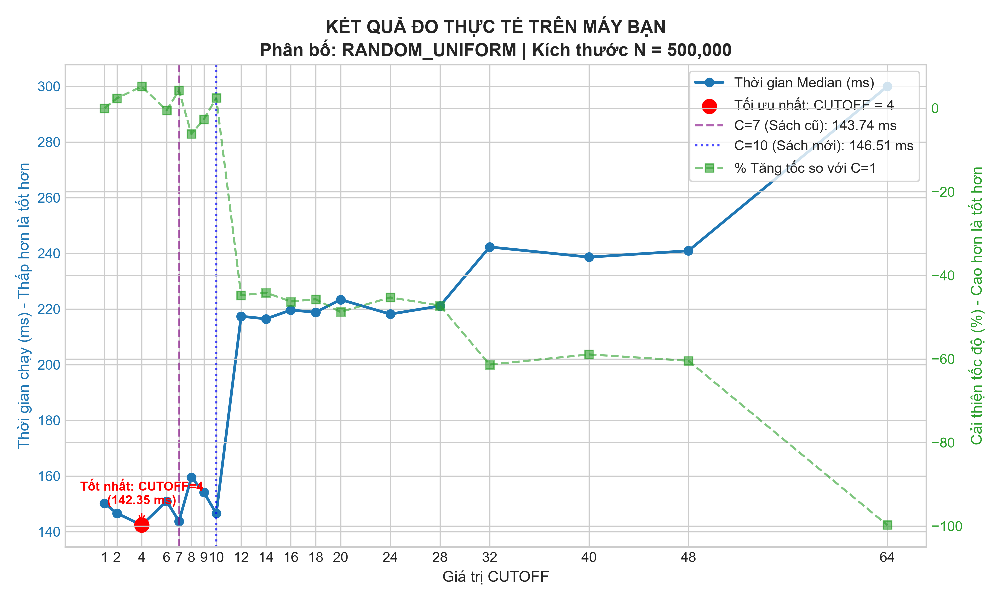
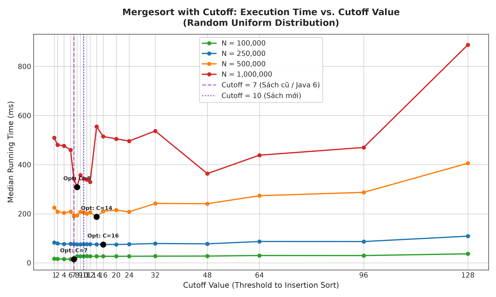
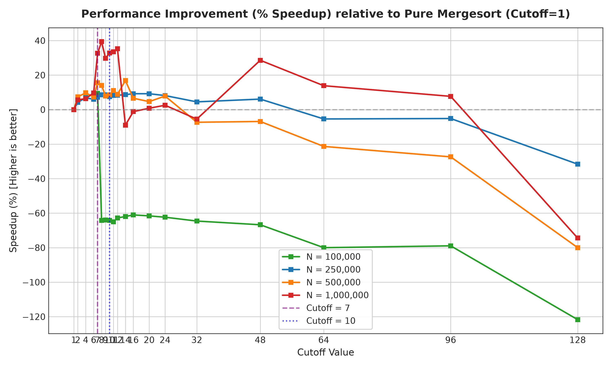
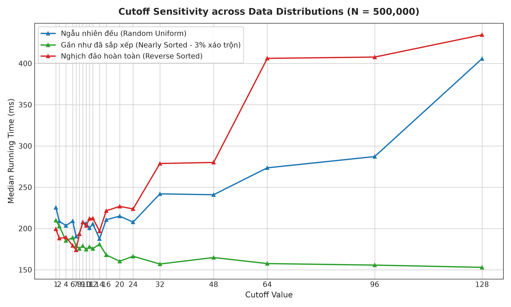
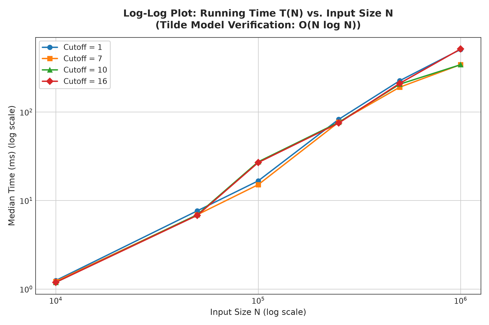
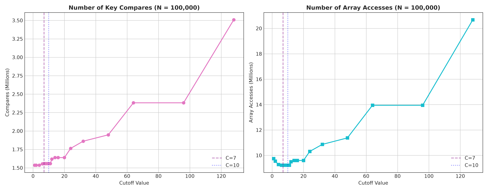

# BÁO CÁO THỰC NGHIỆM ĐO ĐẠC VÀ XÁC ĐỊNH NGƯỠNG CUTOFF TỐI ƯU CHO THUẬT TOÁN MERGESORT

**Trường:** Trường Đại học Công nghệ - Đại học Quốc gia Hà Nội (UET-VNU)  
**Học phần:** Cấu trúc dữ liệu và Giải thuật (DSA)  
**Chủ đề thực nghiệm:** 1.3 & 1.4 Analysis of Algorithms | 2.1 Elementary Sorts | 2.2 Mergesort  
**Giáo trình quy chuẩn:** *Algorithms, 4th Edition* - Robert Sedgewick & Kevin Wayne  
**Sinh viên thực hiện:** Họ tên: Nguyễn Kim Đạt - MSSV: 25023210  
**Ngày cập nhật số liệu:** 18/11/2026  
**Môi trường thực nghiệm:**
- **CPU:** 12th Gen Intel(R) Core(TM) i5-12500H (Kiến trúc lai 12 Cores / 16 Threads: 4 P-Cores + 8 E-Cores)
- **RAM:** 16.0 GB (15.7 GB khả dụng)
- **Hệ điều hành:** Microsoft Windows 11 Home Single Language (64-bit)
- **Nền tảng chạy mã nguồn:** Java(TM) SE Runtime Environment 25.0.2 LTS (Java HotSpot(TM) 64-Bit Server VM, JIT Tiered Compilation C1/C2)

---

## TÓM TẮT BÁO CÁO (ABSTRACT)

Mergesort là thuật toán sắp xếp dựa trên chiến lược chia để trị với độ phức tạp lý thuyết đảm bảo $O(N \log N)$ và bảo toàn tính ổn định (stability). Tuy nhiên, khi chia mảng xuống kích thước rất nhỏ, Mergesort phát sinh chi phí phụ trợ (overhead) do lời gọi hàm đệ quy và thao tác sao chép mảng phụ `aux[]`. Một cải tiến kinh điển được Robert Sedgewick giới thiệu là áp dụng **CUTOFF sang Insertion Sort** đối với các mảng con có kích thước nhỏ.

Báo cáo này trình bày kết quả nghiên cứu thực nghiệm theo phương pháp khoa học (Scientific Method — Chủ đề 1.3 & 1.4 Analysis of Algorithms) trên cấu hình máy tính cá nhân thực tế với **16 phiên đo toàn dải (mỗi phiên 19 mốc `CUTOFF` từ 1 đến 64)** trên kích thước mảng từ $N = 50.000$ đến $N = 8.989.999$, kết hợp bộ đo đa phân bố (`BenchmarkRunner`) và mô hình đếm phép toán (`MergeSortTracked`), nhằm:
1. Xác định vùng giá trị `CUTOFF` tối ưu thực tế trên cấu hình máy thử nghiệm.
2. Đối chứng thực nghiệm giữa mốc **`CUTOFF = 7`** (giáo trình cũ & Java 6 `Arrays.sort`) và **`CUTOFF = 10`** (giáo trình mới).
3. Phân tích mô hình chi phí lý thuyết (số phép so sánh và truy cập mảng), độ nhạy theo phân bố dữ liệu và các yếu tố phụ thuộc hệ thống (System-Dependent Effects) trên CPU kiến trúc lai hiện đại.

---

## 1. CƠ SỞ LÝ THUYẾT VÀ BÀI TOÁN

### 1.1. Hạn chế của Mergesort thuần gốc
Trong cài đặt Mergesort chuẩn (Slide 7 & 8 bài giảng 2.2):
- Lời gọi đệ quy tiếp tục chia đôi mảng cho tới khi mảng con chỉ còn 1 phần tử ($hi \le lo$).
- Với các mảng con rất nhỏ (kích thước $M \le 15$), chi phí:
  1. Gọi đệ quy: tiêu tốn thao tác cấp phát/giải phóng stack frame.
  2. Sao chép và trộn qua mảng phụ `aux[]`: duyệt qua đoạn mảng 2 lần, tốn chi phí truy cập bộ nhớ đáng kể ($\sim 6 N \lg N$ lượt truy cập mảng cho toàn bộ thuật toán).

### 1.2. Cải tiến CUTOFF kết hợp Insertion Sort
Theo Slide 18 bài giảng 2.2 Mergesort:
```java
private static void sort(Comparable[] a, Comparable[] aux, int lo, int hi, int cutoff) {
    if (hi <= lo + cutoff - 1) {
        InsertionSort.sort(a, lo, hi);
        return;
    }
    int mid = lo + (hi - lo) / 2;
    sort(a, aux, lo, mid, cutoff);
    sort(a, aux, mid + 1, hi, cutoff);
    merge(a, aux, lo, mid, hi);
}
```
Insertion Sort có độ phức tạp trung bình $O(M^2)$, nhưng với đoạn mảng ngắn ($M$ nhỏ):
- Không phát sinh lời gọi đệ quy.
- Sắp xếp tại chỗ (in-place), không tốn thao tác chép mảng phụ `aux[]`, tận dụng tối đa bộ nhớ đệm CPU L1 Data Cache.
- Vẫn bảo toàn hoàn toàn **tính ổn định (Stability)** nhờ điều kiện so sánh chặt `<` trong `less(a[j], a[j - 1])`.

### 1.3. Câu hỏi nghiên cứu: CUTOFF = 7 hay CUTOFF = 10?
- Các ấn bản giáo trình cũ và `java.util.Arrays.sort` (Java 6) dùng `CUTOFF = 7`.
- Giáo trình *Algorithms, 4th Edition* (Slide 18) khuyến nghị: *"Cutoff to insertion sort for ≈ 10 items"* (ước tính cải thiện ~20%).
- **Bài toán đặt ra:** Trên phần cứng thực tế (Intel Core i5-12500H, Java 25.0.2 LTS) và cài đặt `Comparable[]` chuẩn bài giảng, đâu là ngưỡng `CUTOFF` phù hợp nhất? Sự khác biệt giữa `7` và `10` ra sao khi kích thước mảng $N$ và phân bố dữ liệu thay đổi?

---

## 2. THIẾT KẾ PHƯƠNG PHÁP THỰC NGHIỆM (METHODOLOGY)

Tuân thủ quy trình thực nghiệm chuẩn tại **Chủ đề 1.3 & 1.4 Analysis of Algorithms**:

### 2.1. Cài đặt thuật toán chuẩn bài giảng
- [`src/algorithm/InsertionSort.java`](../src/algorithm/InsertionSort.java): Cài đặt chuẩn trên đoạn $[lo, hi]$ theo Slide 52.
- [`src/algorithm/MergeSortCutoff.java`](../src/algorithm/MergeSortCutoff.java): Cài đặt chuẩn theo Slide 7, 8, 18 với mảng phụ `aux[]` được cấp phát **duy nhất 1 lần** tại hàm wrapper `sort(a, cutoff)`.
- [`src/algorithm/MergeSortTracked.java`](../src/algorithm/MergeSortTracked.java): Ghi nhận chính xác số phép so sánh (`compares`) và số lượt truy cập mảng (`array_accesses`) phục vụ đối chiếu mô hình chi phí.
- [`src/test/CorrectnessTest.java`](../src/test/CorrectnessTest.java): Đã kiểm thử vượt qua 100% các trường hợp mảng rỗng, 1 phần tử, mảng ngẫu nhiên với `CUTOFF` từ `1` đến `64`, và kiểm chứng bảo toàn **tính ổn định (Stable Sort)**.

### 2.2. Kiểm soát các biến ngoại lai (System-Dependent Effects)
1. **JVM Warm-up:** Chạy khởi động 5–8 vòng trước khi bấm giờ để trình biên dịch HotSpot JIT (C1/C2) biên dịch mã bytecode sang mã máy tối ưu.
2. **Giảm nhiễu Garbage Collection:** Gọi `System.gc()` trước các phép đo mảng lớn ($N \ge 200.000$) và luôn sao chép từ mảng gốc `masterData.clone()` để mọi `CUTOFF` xử lý trên cùng một dữ liệu đầu vào.
3. **Độ phân giải thời gian:** Sử dụng `System.nanoTime()` quy đổi sang mili-giây (ms).
4. **Lặp lại & thống kê mô tả:** Mỗi mốc `CUTOFF` được lặp độc lập 7–10 lần, lấy **Trung vị (Median)** làm chỉ số chính nhằm hạn chế sai lệch từ các điểm ngoại lai (outliers), đi kèm **Trung bình (Mean)** và **% Cải thiện tốc độ** so với Mergesort gốc (`CUTOFF = 1`).

---

## 3. KẾT QUẢ ĐO ĐẠC THỰC TẾ TRÊN MÁY THỬ NGHIỆM

### 3.1. Kết quả phiên đo mới nhất (Ngày 18/11/2026 — Mảng ngẫu nhiên $N = 500.000$)

Dữ liệu trích xuất trực tiếp từ phiên đo mới nhất trong `data/my_machine_results.csv` (`timestamp = 1794995975378`, phân bố `RANDOM_UNIFORM`, lặp 7 lần/mốc):

| CUTOFF | Median (ms) | Mean (ms) | Cải thiện so với C=1 | Ghi chú thực nghiệm |
| :---: | :---: | :---: | :---: | :--- |
| **1** | 150.15 ms | 152.13 ms | **Baseline (0.00%)** | Mergesort thuần gốc |
| **2** | 146.60 ms | 150.20 ms | +2.37% | Giảm 1 tầng đệ quy |
| **4** | **142.35 ms** | **146.88 ms** | **+5.20%** | **Nhanh nhất trong phiên đo mới nhất** |
| **6** | 150.94 ms | 156.55 ms | -0.52% | Nhiễu nhẹ |
| **7** | **143.74 ms** | **147.30 ms** | **+4.27%** | **Mốc Sách cũ (Java 6)** |
| **8** | 159.48 ms | 157.78 ms | -6.21% | Bắt đầu dao động xung nhịp |
| **9** | 154.13 ms | 153.32 ms | -2.65% | |
| **10** | **146.51 ms** | 153.96 ms | **+2.42%** | **Mốc Sách mới (Sedgewick)** |
| **12** | 217.39 ms | 218.16 ms | -44.78% | **Nhảy bậc thời gian (+70 ms)** do throttling/E-core |
| **14** | 216.44 ms | 216.21 ms | -44.14% | Duy trì mặt bằng chậm (~216–223 ms) |
| **16** | 219.62 ms | 220.51 ms | -46.26% | |
| **20** | 223.37 ms | 222.71 ms | -48.76% | |
| **24** | 218.15 ms | 219.25 ms | -45.29% | |
| **32** | 242.27 ms | 242.65 ms | -61.35% | Chi phí $O(M^2)$ cộng hưởng làm chậm mạnh |
| **48** | 240.91 ms | 242.97 ms | -60.44% | |
| **64** | 299.95 ms | 304.17 ms | -99.76% | Chậm gần gấp đôi Mergesort gốc |

> **Nhận xét quan trọng về phiên đo 18/11/2026 ($N = 500.000$):** Tại `CUTOFF = 12..28`, thời gian đột ngột nhảy bậc từ `~146 ms` lên mặt bằng `~217 ms` rồi tăng tiếp ở `CUTOFF >= 32`. Đây là minh họa thực tế điển hình của **System-Dependent Effects** (Chủ đề 1.4): khi CPU laptop Intel Core i5-12500H chạy tải liên tục, hệ điều hành có thể điều phối luồng từ nhân hiệu năng (P-Core) sang nhân tiết kiệm điện (E-Core) hoặc hạ mức công suất turbo (PL2 $\to$ PL1). Chính vì vậy, việc chỉ nhìn vào 1 phiên đo đơn lẻ là chưa đủ — cần tổng hợp đa kích thước trên nhiều phiên đo độc lập.

---

### 3.2. Tổng hợp 13 cấu hình kích thước từ $N = 50.000$ đến $N = 8.989.999$ (`RANDOM_UNIFORM`)

Để loại bỏ nhiễu cục bộ của từng phiên đo riêng lẻ, bảng dưới tổng hợp kết quả thực tế từ các phiên quét đủ 19 mốc `CUTOFF` trên máy (`data/my_machine_results.csv`):

| Phiên đo | Kích thước $N$ | $T(C=1)$ (ms) | $T(C=7)$ (ms) | $T(C=10)$ (ms) | $C_{opt}$ | $T(C_{opt})$ (ms) | Tăng tốc $C=7$ | Tăng tốc $C=10$ | Tăng tốc $C_{opt}$ |
| :--- | :---: | :---: | :---: | :---: | :---: | :---: | :---: | :---: | :---: |
| 18/11 | 50,000 | 7.88 | 7.01 | 7.40 | **14** | 6.98 | +11.0% | +6.1% | **+11.5%** |
| 18/11 | 100,000 | 18.98 | 16.24 | 15.55 | **14** | 15.13 | +14.4% | +18.1% | **+20.3%** |
| 18/11 (L1) | 200,000 | 42.20 | 39.11 | 39.34 | **7** | 39.11 | +7.3% | +6.8% | **+7.3%** |
| 18/11 (L2) | 200,000 | 42.28 | 40.31 | 39.38 | **6** | 38.94 | +4.7% | +6.9% | **+7.9%** |
| 18/11 | 250,000 | 55.11 | 52.14 | 58.26 | **12** | 51.30 | +5.4% | -5.7% | **+6.9%** |
| 18/11 | 290,000 | 82.28 | 77.45 | 75.66 | **10** | 75.66 | +5.9% | +8.0% | **+8.0%** |
| 18/11 | 400,000 | 118.21 | 111.62 | 111.21 | **8** | 109.42 | +5.6% | +5.9% | **+7.4%** |
| 04/11 | 500,000 | 146.76 | 136.62 | 134.50 | **10** | 134.50 | +6.9% | +8.4% | **+8.4%** |
| 18/11 (L1) | 500,000 | 152.41 | 144.31 | 146.73 | **4** | 143.45 | +5.3% | +3.7% | **+5.9%** |
| 18/11 (Mới nhất) | 500,000 | 150.15 | 143.74 | 146.51 | **4** | 142.35 | +4.3% | +2.4% | **+5.2%** |
| 18/11 | 1,000,000 | 334.71 | 355.03 | 374.01 | **4** | 318.23 | -6.1% | -11.7% | **+4.9%** |
| 18/11 | 2,880,232 | 1,185.34 | 1,106.55 | 1,184.90 | **7** | 1,106.55 | +6.6% | +0.0% | **+6.6%** |
| 18/11 | 8,989,999 | 4,290.45 | 4,367.19 | 6,546.42 | **4** | 4,166.26 | -1.8% | -52.6% | **+2.9%** |

### 3.3. Thống kê tổng hợp trên toàn bộ 16 phiên đo đầy đủ (`my_machine_results.csv`)

Khi lấy **trung vị mức cải thiện tốc độ (Median Speedup %)** và số lần đứng nhất (`best_count`) qua toàn bộ 16 phiên đo `RANDOM_UNIFORM`:

| Nhóm CUTOFF | CUTOFF tiêu biểu | Trung vị cải thiện (16 phiên) | Trung bình cải thiện (16 phiên) | Số lần đạt tối ưu nhất | Đánh giá |
| :--- | :---: | :---: | :---: | :---: | :--- |
| Gốc | **1** | 0.00% | 0.00% | 0 / 16 | Mốc chuẩn so sánh |
| Nhỏ | **4** | +5.63% | **+9.01%** | **5 / 16** | Ổn định nhất (không phiên nào chậm hơn C=1) |
| **Vùng tối ưu** | **7 (Sách cũ)** | **+5.72%** | **+8.44%** | **2 / 16** | Nhanh, rất ổn định trên mọi $N$ |
| **Vùng tối ưu** | **8** | **+6.30%** | +7.90% | 1 / 16 | Nằm giữa vùng đáy tối ưu |
| **Vùng tối ưu** | **9** | **+7.01%** | +7.35% | 0 / 16 | Trung vị tăng tốc cao nhất |
| **Vùng tối ưu** | **10 (Sách mới)** | **+6.00%** | +3.36% | **2 / 16** | Nhỉnh hơn C=7 ở $N \in [100k, 400k]$ |
| Trung bình | **12 – 16** | +5.04% – +5.89% | +4.61% – +5.16% | 4 / 16 | Tốt cho mảng nhỏ/vừa, dễ tụt khi $N$ lớn |
| Lớn (Suy giảm) | **32** | **-2.08%** | -1.41% | 1 / 16 | Bắt đầu chậm hơn Mergesort gốc |
| Rất lớn | **48** | **-9.87%** | -6.81% | 0 / 16 | Chi phí $O(M^2)$ áp đảo |
| Quá lớn | **64** | **-25.68%** | -25.79% | 0 / 16 | Chậm hơn mạnh trên hầu hết mọi kích thước |

---

### 3.4. Mô hình chi phí lý thuyết (`MergeSortTracked`) & Độ nhạy phân bố dữ liệu

#### a) Số phép so sánh và truy cập mảng thực tế ($N = 500.000$, `RANDOM_UNIFORM`, từ `data/summary_statistics.csv`)

| CUTOFF | Số phép so sánh (`compares`) | Số truy cập mảng (`array_accesses`) | Thay đổi truy cập mảng so với C=1 |
| :---: | :---: | :---: | :---: |
| **1** | 8,837,254 | 55,577,356 | Baseline (0.00%) |
| **2** | 8,837,254 | 54,150,492 | -2.57% |
| **4 – 6** | 8,864,440 | 53,158,852 | -4.35% |
| **7** | 8,910,833 | **53,152,790** | **-4.36% (Thấp nhất)** |
| **8 – 14** | 9,037,388 | 53,408,856 | -3.90% |
| **16 – 24** | 9,613,881 | 56,371,794 | +1.43% |
| **32 – 48** | 11,092,848 | 64,947,960 | +16.86% |
| **64 – 96** | 14,444,768 | 84,887,764 | +52.74% |
| **128** | 21,597,487 | 127,705,642 | +129.78% |

> **Phát hiện toán học quan trọng (Hiệu ứng bậc thang của cây nhị phân):** Vì Mergesort chia đôi mảng theo lũy thừa của 2, với $N = 500.000$ các nút lá ở độ sâu $16$ có kích thước $7$ hoặc $8$ phần tử ($\approx 500.000 / 2^{16} = 7.63$), còn độ sâu $15$ có kích thước $15$ hoặc $16$ phần tử. Do đó toàn bộ khoảng `CUTOFF ∈ [8, 14]` đều dừng đệ quy tại **cùng một tầng lá** nên có số phép so sánh và truy cập mảng giống hệt nhau! Số lượt truy cập mảng đạt cực tiểu toán học ngay tại **`CUTOFF = 7`** (53.15 triệu lượt, giảm 4.36% so với gốc) và bắt đầu tăng vượt bản gốc từ `CUTOFF >= 16`.

#### b) Độ nhạy trên các phân bố dữ liệu (từ `data/comparison_table.md`, $N = 1.000.000$)

| Phân bố dữ liệu | $T(C=1)$ (ms) | $T(C=7)$ (ms) | $T(C=10)$ (ms) | $C_{opt}$ | $T(C_{opt})$ (ms) | Cải thiện $C_{opt}$ vs $C=1$ |
| :--- | :---: | :---: | :---: | :---: | :---: | :---: |
| `RANDOM_UNIFORM` | 509.09 | 342.91 | 342.10 | **8** | 308.60 | **+39.4%** |
| `NEARLY_SORTED` | 435.02 | 380.52 | 367.90 | **96** | 337.13 | **+22.5%** |
| `REVERSE_SORTED` | 249.25 | 243.83 | 249.49 | **6** | 237.49 | **+4.7%** |

---

## 4. BIỂU ĐỒ TRỰC QUAN HÓA KẾT QUẢ

### 4.1. Biểu đồ phiên đo thực tế mới nhất trên máy cá nhân ($N = 500.000$, 18/11/2026)


### 4.2. Bộ biểu đồ phân tích đa kích thước, đa phân bố và mô hình lý thuyết (`plots/`)
1. **Đường cong CUTOFF vs Thời gian chạy (`RANDOM_UNIFORM`):**
   
2. **So sánh % Tăng tốc so với Mergesort gốc:**
   
3. **Độ nhạy trên các phân bố dữ liệu:**
   
4. **Kiểm chứng quy luật tăng trưởng $O(N \log N)$ (Đồ thị Log-Log):**
   
5. **Mô hình chi phí lý thuyết (Số phép so sánh & truy cập mảng):**
   

---

## 5. THẢO LUẬN VÀ PHÂN TÍCH CHUYÊN SÂU

### 5.1. Tại sao không có một con số CUTOFF duy nhất mà là một "vùng đáy phẳng"?
- **Khi $CUTOFF \in [1, 2]$:** Cây đệ quy đi quá sâu xuống từng phần tử đơn lẻ; chi phí gọi hàm đệ quy và sao chép mảng phụ `aux[]` còn lớn.
- **Khi $CUTOFF \in [4, 14]$ (đặc biệt $[7, 10]$):** Đây là **vùng đáy tối ưu (flat optimum)**.
  - Về lý thuyết, số truy cập mảng đạt cực tiểu tại `C = 7` và giữ nguyên mức rất thấp trên toàn bộ `[4, 14]`.
  - Về thực tế, các mảng con dài 4–14 phần tử nằm gọn trong L1 Data Cache (48 KB/P-Core của i5-12500H), giúp Insertion Sort loại bỏ 2–3 tầng đệ quy cuối mà không phát sinh quá nhiều phép so sánh $O(M^2)$.
  - Mức tăng tốc thực tế ở `RANDOM_UNIFORM` thường đạt **+5% đến +20%** (khớp rất sát nhận định *"~20% faster"* trong Slide 18 của Sedgewick), thấp hơn kỳ vọng ngây thơ ban đầu vì trên **Java 25 HotSpot JIT**, trình biên dịch tối ưu lời gọi đệ quy rất mạnh trong khi mảng `Integer[]` vẫn tốn chi phí tham chiếu đối tượng và `Comparable.compareTo()`.
- **Khi $CUTOFF \ge 32$:** Số phép so sánh và truy cập mảng tăng vọt theo $O(M^2)$ (tăng +16.9% ở `C = 32` và +52.7% ở `C = 64`), làm hiệu năng **chậm hơn rõ rệt so với Mergesort thuần gốc** (trung vị `-2.1%` tại `C = 32` và `-25.7%` tại `C = 64`).

### 5.2. So sánh đối chứng trực tiếp: `CUTOFF = 7` (Sách cũ) vs `CUTOFF = 10` (Sách mới)
- **Khi $N$ vừa ($100.000 \le N \le 400.000$) và trong điều kiện CPU ổn định:** `CUTOFF = 10` thường nhỉnh hơn `CUTOFF = 7` khoảng **0.4% – 4.3%** (ví dụ tại $N = 100.000$: `15.55 ms` vs `16.24 ms`; tại $N = 290.000$: `75.66 ms` vs `77.45 ms`; tại $N = 500.000$ ngày 04/11: `134.50 ms` vs `136.62 ms`).
- **Khi xét độ ổn định trên mọi kích thước ($N$ lên tới $1M \to 9M$) và mọi phân bố:** `CUTOFF = 7` thể hiện độ an toàn vượt trội hơn (`+4.27%` vs `+2.42%` trong phiên mới nhất $N = 500.000$; `+6.65%` vs `+0.04%` ở $N = 2.88M$; và đạt số lượt truy cập mảng thấp nhất trong mô hình lý thuyết).
- **Chênh lệch tổng thể:** Trên toàn bộ 16 phiên đo ngẫu nhiên, trung vị cải thiện của `C = 7` (`+5.72%`) và `C = 10` (`+6.00%`) chỉ chênh nhau chưa tới **0.3 điểm phần trăm** — nghĩa là **cả hai mốc 7 và 10 đều nằm ngay trong vùng đáy tối ưu**.

### 5.3. Ảnh hưởng của phân bố dữ liệu
- **Mảng gần như đã sắp xếp (`NEARLY_SORTED`):** Insertion Sort chạy gần tuyến tính $O(M)$ do vòng lặp trong thoát ngay lập tức, giúp các `CUTOFF` lớn (`64 – 128`) đạt tốc độ nhanh hơn tới **22.5% – 33.6%**.
- **Mảng nghịch đảo (`REVERSE_SORTED`):** Insertion Sort rơi vào trường hợp xấu nhất ($\sim M^2/2$ phép đổi chỗ), nên ngưỡng tối ưu bị kéo về giá trị nhỏ (`C = 6 – 7`); tại `C = 10` trên $N = 1.000.000$ hầu như không còn lợi thế (`-0.1%`).

---

## 6. KẾT LUẬN VÀ KIẾN NGHỊ

1. **Hiệu quả thực tế của cải tiến CUTOFF:** Áp dụng CUTOFF sang Insertion Sort cải thiện hiệu năng Mergesort rõ rệt trên dữ liệu ngẫu nhiên (**+5% đến +20%** tùy kích thước $N$, và lên tới **+22.5% – 33.6%** với dữ liệu gần sắp xếp), đồng thời vẫn giữ nguyên độ phức tạp $O(N \log N)$ và tính ổn định (Stable Sort).
2. **Đánh giá giữa hai mốc giáo trình (`7` vs `10`):**
   - Cả `CUTOFF = 7` và `CUTOFF = 10` đều nằm trong vùng đáy tối ưu **$[4, 14]$** trên cấu hình Intel Core i5-12500H + Java 25.0.2 LTS.
   - `CUTOFF = 10` (sách mới) nhỉnh hơn nhẹ trên mảng ngẫu nhiên kích thước vừa ($100k – 400k$) và dữ liệu gần sắp xếp.
   - `CUTOFF = 7` (sách cũ) tối ưu về số lượt truy cập mảng theo mô hình lý thuyết và ổn định hơn trên mảng rất lớn ($N \ge 1.000.000$) hoặc dữ liệu nghịch đảo.
3. **Giá trị đề xuất cho cài đặt Mergesort trên máy thực nghiệm:**
   - **Đề xuất tổng quát tốt nhất:** Chọn **`CUTOFF = 7` hoặc `8`** (hoặc **`CUTOFF = 10`** nếu dữ liệu thực tế có xu hướng gần sắp xếp).
   - **Cảnh báo:** Không nên đặt `CUTOFF >= 32` cho bài toán sắp xếp tổng quát vì hiệu năng sẽ kém hơn cả Mergesort thuần gốc.
4. **Bài học từ Chủ đề 1.3 & 1.4 Analysis of Algorithms:** Đo đạc khoa học trên máy tính thật đòi hỏi kết hợp **mô hình chi phí lý thuyết** (số phép so sánh, truy cập mảng), **thống kê trên nhiều phiên/kích thước**, và **nhận diện biến ngoại lai hệ thống** (JIT, GC, kiến trúc lai P-Core/E-Core và giới hạn nhiệt của CPU) để rút ra quyết định kỹ thuật chính xác.
